

  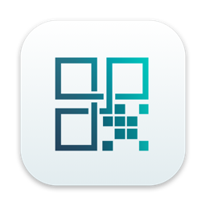

<h1 align="center">Tethera</h1>

  <b>Desktop remoto VNC nativo per iPhone, iPad e Mac.</b> 
  Veloce, leggero e riservato: controlla i tuoi Mac, Linux e Windows a casa, in ufficio o da ovunque.

  <a href="README.md">English</a> · <b>Italiano</b>

  
  
  

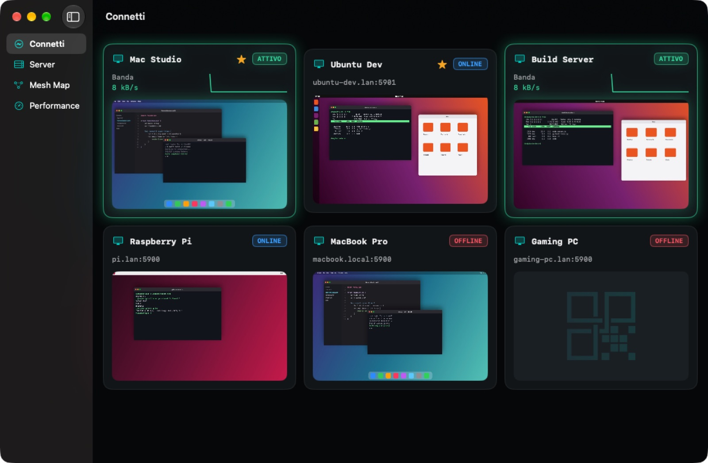

  <a href="video/tethera-mac-it.mp4">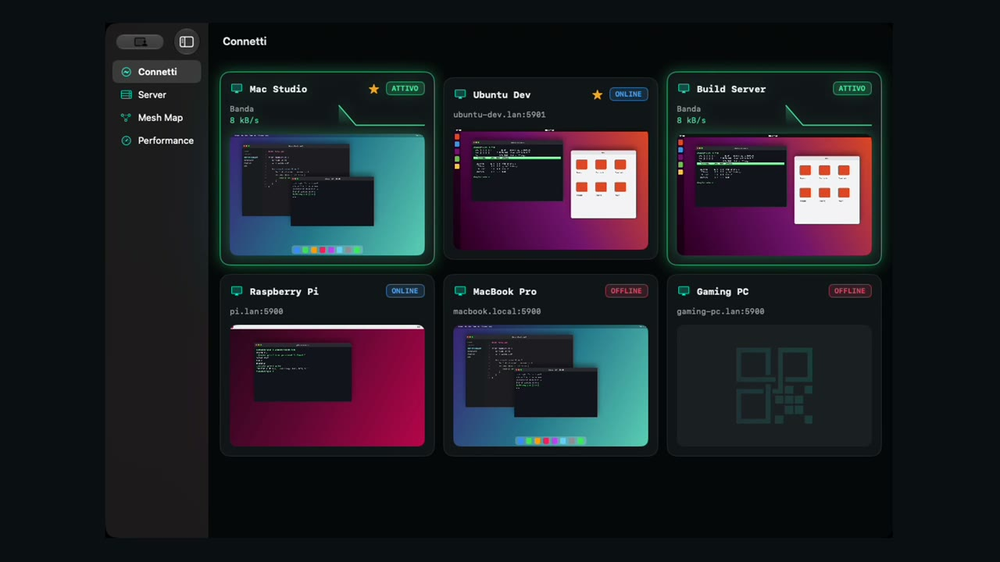</a> 
  ▶︎ <a href="video/tethera-mac-it.mp4">Guarda il video (40 s)</a>

## Indice

- [Funzioni](#funzioni)
- [Requisiti di sistema](#requisiti-di-sistema)
- [Download](#download)
- [Guida](#guida)
  - [1. Preparare il computer da controllare](#1-preparare-il-computer-da-controllare)
  - [2. Aggiungere un server](#2-aggiungere-un-server)
  - [3. Collegarsi](#3-collegarsi)
  - [4. Gesti: un mouse sotto il dito](#4-gesti-un-mouse-sotto-il-dito)
  - [5. Tastiera e Macro Bar](#5-tastiera-e-macro-bar)
  - [6. Copia e incolla](#6-copia-e-incolla)
  - [7. Zoom, orientamento e barra della sessione](#7-zoom-orientamento-e-barra-della-sessione)
  - [8. Profili e risoluzione](#8-profili-e-risoluzione)
  - [9. Connessioni cifrate: tunnel SSH](#9-connessioni-cifrate-tunnel-ssh)
  - [10. Fuori casa, senza aprire porte](#10-fuori-casa-senza-aprire-porte)
  - [11. Trasferire file](#11-trasferire-file)
  - [12. Sincronizzazione tra iPhone, iPad e Mac](#12-sincronizzazione-tra-iphone-ipad-e-mac)
  - [13. Wake-on-LAN e computer nelle vicinanze](#13-wake-on-lan-e-computer-nelle-vicinanze)
  - [14. Home, Rete e Performance](#14-home-rete-e-performance)
  - [15. Siri, Comandi Rapidi, widget e Handoff](#15-siri-comandi-rapidi-widget-e-handoff)
  - [16. Impostazioni](#16-impostazioni)
  - [17. Sul Mac](#17-sul-mac)
  - [Scorciatoie da tastiera](#scorciatoie-da-tastiera)
- [Sicurezza e privacy](#sicurezza-e-privacy)
- [Risoluzione dei problemi](#risoluzione-dei-problemi)
- [Supporto](#supporto)

## Funzioni

- **Funziona con ogni server VNC**: Condivisione Schermo di macOS (con il tuo account del Mac), TigerVNC, x11vnc,
  wayvnc su Linux, TightVNC, UltraVNC e RealVNC su Windows, Raspberry Pi.
- **Fluido e nitido**: disegno con la GPU (Metal), encoding moderni compressi, video H.264 in hardware con wayvnc.
- **Il dito è un mouse**: tocco, doppio tocco, tocca e trascina per selezionare, due dita per il clic destro e lo
  scorrimento, tre dita per il clic centrale; oppure la modalità trackpad come su un portatile, con accelerazione.
  Su iPad mouse e trackpad funzionano come su un computer e la Apple Pencil disegna e seleziona con precisione.
- **Copia e incolla che funziona e basta**: ⌘C e ⌘V copiano e incollano sul computer remoto, e il testo passa tra
  lui e il tuo iPhone, iPad o Mac nei due sensi.
- **Macro Bar**: Esc, Tab, Ctrl, Alt, ⌘, frecce, tasti F e Ctrl+Alt+Canc sempre a portata, sopra la tastiera.
- **Zoom e orizzontale**: pizzica per ingrandire fino a 8×, iPhone in verticale o in orizzontale, barra della
  sessione richiudibile.
- **Fuori casa senza aprire porte**: attraverso un computer di casa sempre acceso (il gateway SSH), scelto da solo
  quando sei fuori. Funzionano anche Tailscale e le altre VPN.
- **File con il trascinamento**: trascina un file sulla finestra della sessione per copiarlo sul computer remoto,
  condividi foto e documenti da qualsiasi app di iPhone e iPad, sfoglia il computer remoto e scaricane i file. Via SSH,
  cifrato.
- **Cifrato quando serve**: tunnel SSH integrato; un lucchetto mostra subito se la sessione è cifrata.
- **Anteprime dal vivo**: la home mostra lo schermo di ogni computer, lo stato online e la banda.
- **Sincronizzazione iCloud**: i tuoi server e le loro password su tutti i tuoi iPhone, iPad e Mac, senza account da creare.
- **Wake-on-LAN**, computer nelle vicinanze trovati da soli, link `vnc://`.
- **Siri, Comandi Rapidi, Spotlight, widget, Centro di Controllo, Live Activity, Handoff e filtri Focus.**
- **Leggero**: circa 100 MB di memoria e nessun uso della CPU quando lo schermo remoto è fermo.
- **5 lingue**: italiano, English, Français, Deutsch, Español, con una guida integrata.

| | |
|---|---|
| 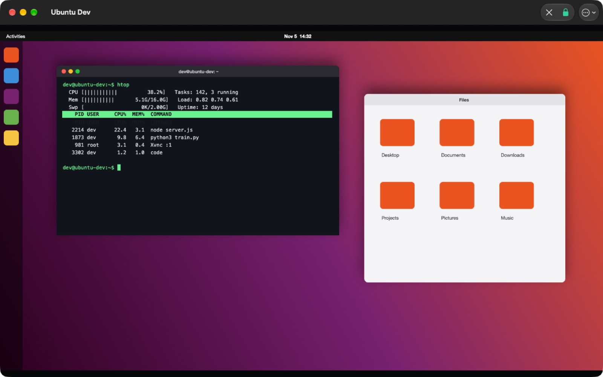 | 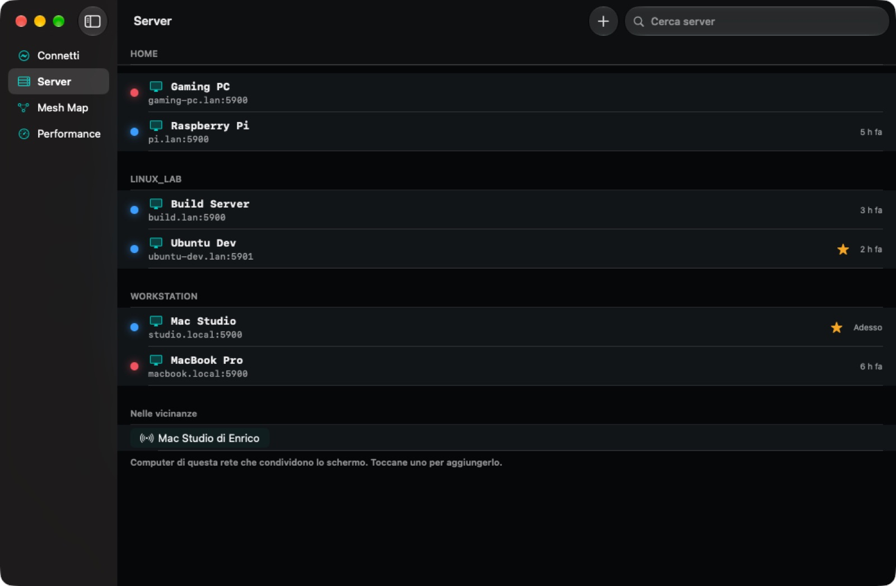 |
| Una sessione nella sua finestra | Server per gruppo, preferiti e computer nelle vicinanze |
| 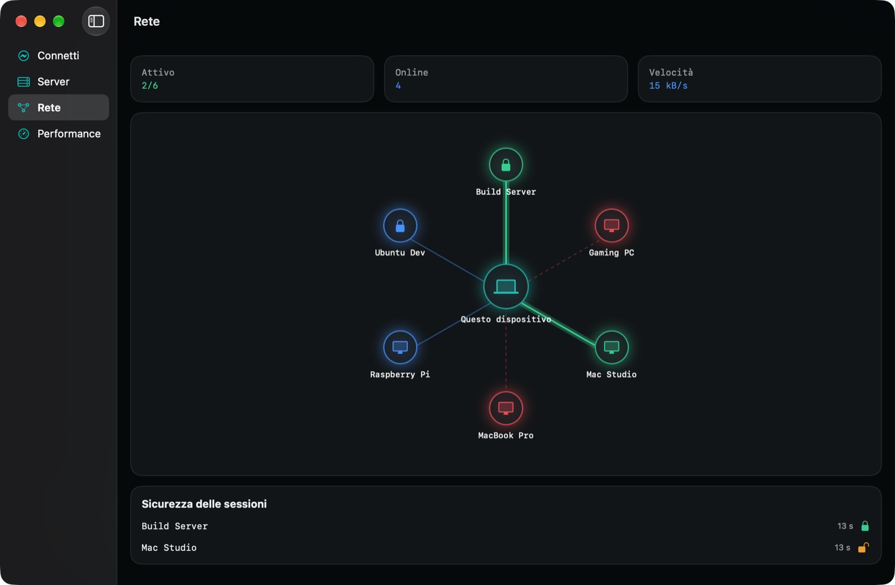 | 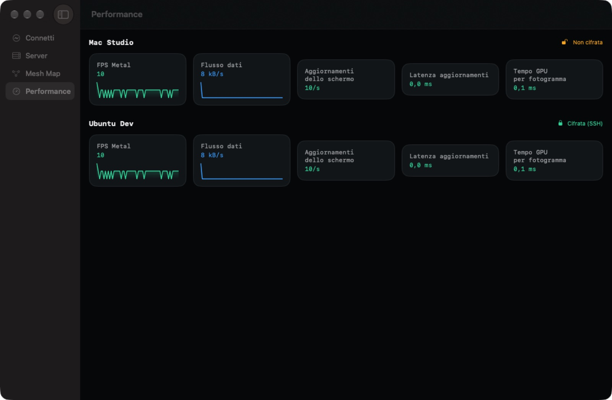 |
| Rete: quali computer sono online, attivi e cifrati | Performance: fotogrammi, flusso dati, latenza |
| 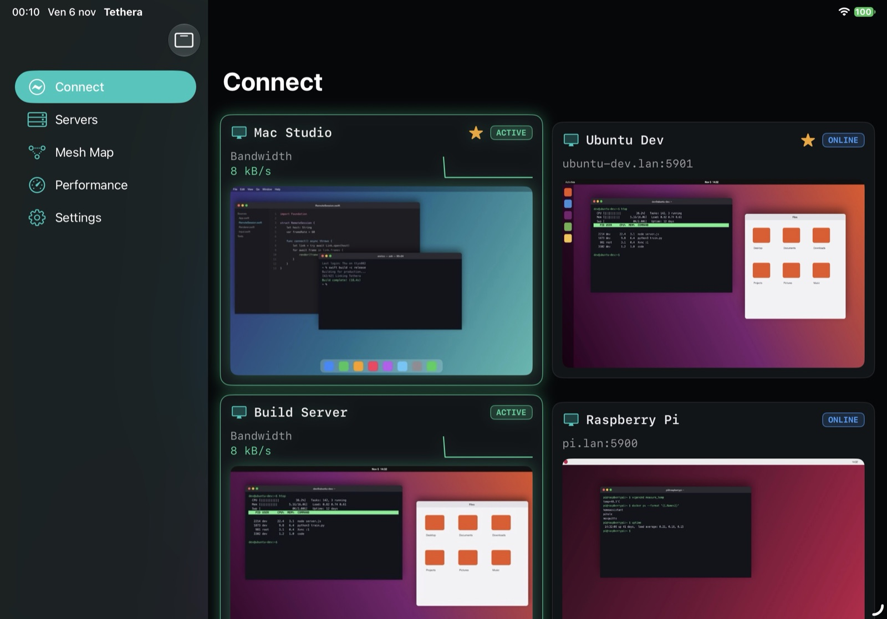 | 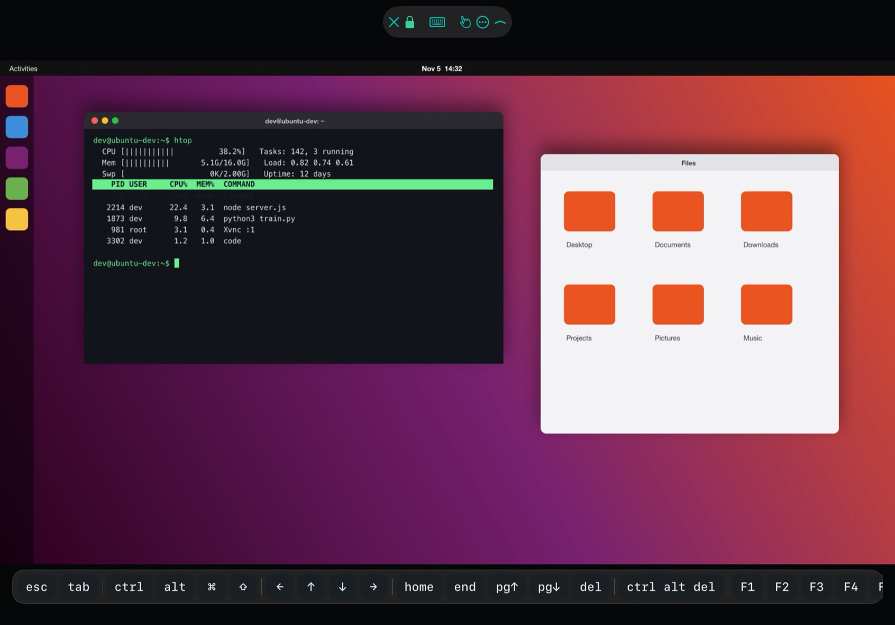 |
| iPad: home con le anteprime dal vivo | iPad: sessione con la Macro Bar |
| 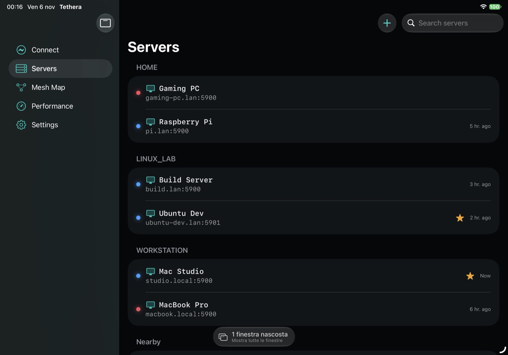 | 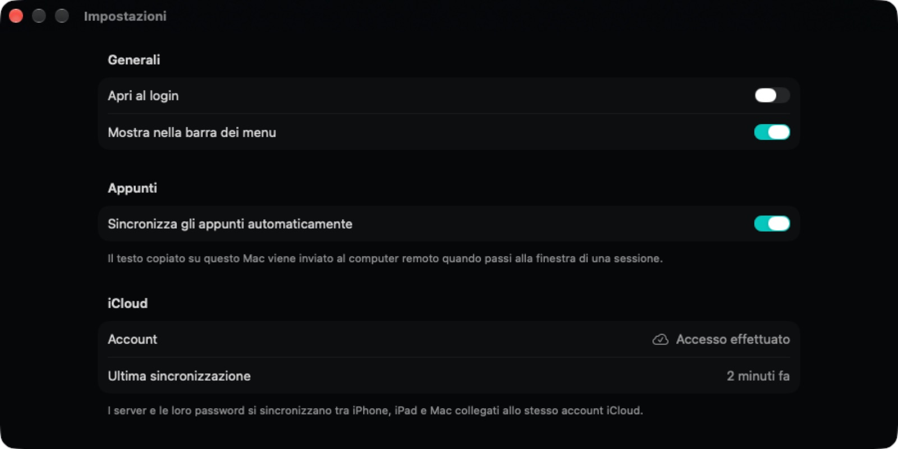 |
| iPad: server | Impostazioni |

  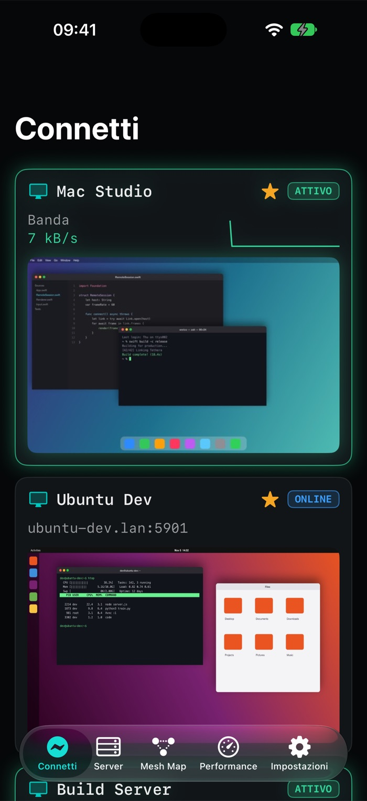
  &nbsp;
  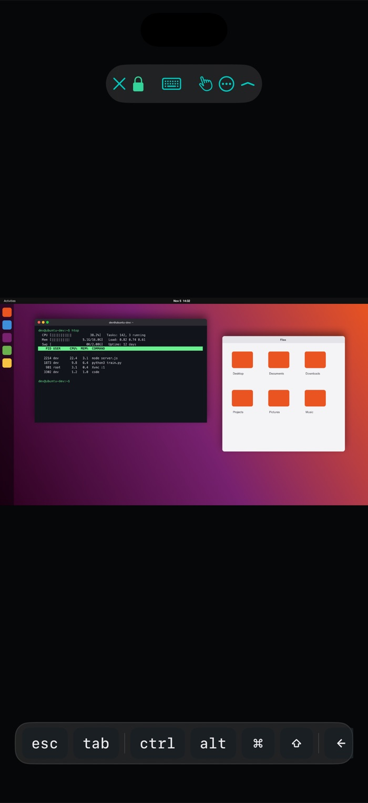
  &nbsp;
  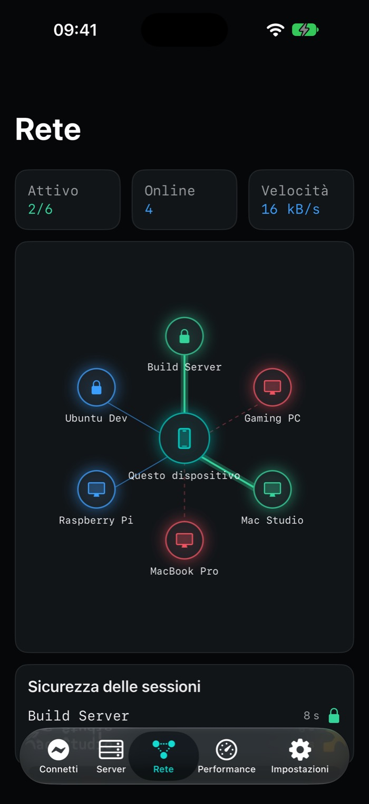

  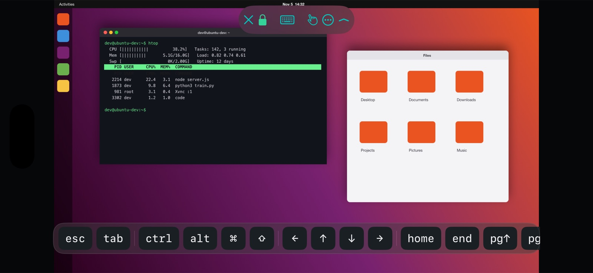

Le immagini dell'iPad sono in inglese.

## Requisiti di sistema

| | iPhone | iPad | Mac |
|---|---|---|---|
| **Sistema operativo** | iOS 18 o successivo | iPadOS 18 o successivo | macOS 15 Sequoia o successivo |
| **Dispositivi** | iPhone XS, XR o successivi | iPad (7ª gen.), iPad mini (5ª gen.), iPad Air (3ª gen.), iPad Pro 11" (1ª gen.) / 12,9" (3ª gen.) o successivi | Apple silicon (M1 o successivi) o Mac Intel con macOS 15 |
| **Aspetto Liquid Glass** | iOS 26 | iPadOS 26 | macOS 26 Tahoe |
| **Blocco dell'app (facoltativo)** | Face ID, Touch ID o codice | Face ID, Touch ID o codice | Touch ID o password del Mac |
| **Tastiera e puntatore** | Facoltativi | Facoltativi (Magic Keyboard, trackpad, mouse, Apple Pencil) | Integrati |

Serve anche un computer con un **server VNC** attivo, raggiungibile dal dispositivo: nella tua rete, oppure da
fuori tramite una VPN (per esempio Tailscale) o un tunnel SSH.

## Download

Tethera arriverà sull'App Store per iPhone, iPad e Mac. La **versione per Mac** si scarica dalla pagina
[Releases](https://github.com/kikoz85/Tethera/releases) di questo repository, dove ogni nuova versione è pubblicata
con le sue note. L'app per Mac si aggiorna da sola quando esce una nuova versione.

Le **versioni per Windows e Linux** sono nella stessa pagina, con la stessa impostazione e le stesse funzioni
dell'app per Mac:

| Sistema | Pacchetto |
|---|---|
| Windows 10 / 11, x64 e arm64 | installer `.msi` |
| Debian, Ubuntu e derivate, x86_64 e arm64 | `.deb` |
| Fedora, RHEL, openSUSE, x86_64 e arm64 | `.rpm` |
| Qualsiasi Linux, x86_64 e arm64, senza installare | `.AppImage` |

Su Linux il video (H.264) usa OpenH264 se è installato (pacchetto `openh264`); senza, Tethera usa le altre
codifiche. I pacchetti per Windows e Linux non sono ancora firmati: SmartScreen può chiedere conferma.

Tethera è gratuita e si usa secondo la [licenza d'uso](LICENSE). I componenti open source che contiene sono elencati,
con le loro licenze, in Impostazioni › Riconoscimenti.

## Guida

### 1. Preparare il computer da controllare

- **Mac**: Impostazioni di Sistema → Generali → Condivisione → **Condivisione schermo** attiva. In Tethera accedi con
  nome e password di un account del Mac abilitato alla Condivisione schermo.
- **Linux**: installa un server VNC come **TigerVNC** (`vncserver`), **x11vnc** o, con Wayland, **wayvnc**, e imposta
  una password VNC.
- **Windows**: installa **TightVNC**, **UltraVNC** o **RealVNC Server** e imposta una password VNC.
- **Raspberry Pi**: Configurazione del Raspberry Pi → Interfacce → **VNC** attivo.

Annota l'indirizzo del computer (per esempio `192.168.1.50`) e la porta (di solito `5900`; TigerVNC usa la `5901`
per il display `:1`).

### 2. Aggiungere un server

1. Apri **Servers** e premi **+** (o ⇧⌘N sul Mac).
2. Compila **Name** (il nome che vedrai nell'elenco), **Host** (indirizzo IP o nome) e **Port**.
3. Facoltativo: un **Group** (Workstation, Linux lab…), **Favorite**, lo **User Name** per un Mac e la **Password**.
   Le password vanno nel Portachiavi.
4. Premi **Save**.

Più rapido: i computer che condividono lo schermo nella tua rete compaiono in **Nearby**, toccane uno per
aggiungerlo; un link `vnc://192.168.1.50:5901` aperto da Safari, Note o Messaggi apre l'editor già compilato.

### 3. Collegarsi

Tocca un server in **Connect** o in **Servers**. Su iPhone la sessione occupa tutto lo schermo; su iPad e Mac ogni
sessione ha la **sua finestra**, così puoi tenere più computer affiancati.

Se il server chiede una password che non hai salvato, Tethera la chiede lì e la salva nel Portachiavi per la
volta successiva (per un Mac anche il nome dell'account). Un'etichetta su ogni server indica se è **Online**,
**Offline** o **Active** (collegato).

### 4. Gesti: un mouse sotto il dito

In modalità **Direct Touch** il puntatore va dove tocchi:

| Gesto | Equivale a |
|---|---|
| Un dito che scorre | Spostare il puntatore |
| Tocco | Clic sinistro |
| Doppio tocco | Doppio clic |
| **Tocca, poi tocca di nuovo e trascina** | Tasto sinistro premuto: seleziona il testo, sposta finestre e icone |
| Tocco con due dita | Clic destro |
| Due dita che scorrono | Rotella (o spostamento quando è ingrandito) |
| Tocco con tre dita | Clic centrale |
| Pressione lunga | Clic destro; muovi il dito dopo la pressione lunga per trascinare |
| Pizzico | Zoom |

La modalità **Trackpad** (il pulsante con la mano nella barra della sessione, o Impostazioni → Touch Input) funziona
come il trackpad di un portatile: il dito sposta il puntatore da dove si trova, il tocco fa clic lì. Scorri piano per
la precisione, veloce per attraversare lo schermo; con lo zoom la vista segue il puntatore.

**Mouse, trackpad e Apple Pencil su iPad** funzionano come su un computer:

| Su iPad | Sul computer remoto |
|---|---|
| Tasti del mouse o del trackpad | Premuti e rilasciati insieme ai tuoi: tieni premuto, trascina, clic destro, clic centrale |
| Due dita sul trackpad, rotella | Scorrimento |
| Apple Pencil sullo schermo | Tasto sinistro premuto: disegna, seleziona, trascina |
| Apple Pencil sopra lo schermo (iPad con hover) | Sposta il puntatore |
| Doppio tocco o pressione sulla Apple Pencil | Clic destro |

### 5. Tastiera e Macro Bar

Tocca il pulsante della **tastiera** nella barra della sessione per mostrare la tastiera su schermo. La **Macro Bar**
sopra di essa ha i tasti che mancano a una tastiera touch: **esc**, **tab**, **ctrl**, **alt**, **⌘**, **⇧**, frecce,
**home**, **end**, pagina su e giù, **del**, **ctrl alt del** e **F1–F12**.

**ctrl**, **alt**, **⌘** e **⇧** restano premuti per il tasto successivo: tocca **ctrl**, poi **a**, per inviare Ctrl+A.
Una tastiera fisica funziona come su un computer; la Macro Bar si può disattivare nelle Impostazioni.

### 6. Copia e incolla

- **⌘C / ⌘X** nella sessione copiano o tagliano sul computer remoto (Tethera invia Ctrl+C a Windows e Linux, ⌘C a un
  Mac) e il testo arriva nei tuoi appunti, pronto da incollare in qualsiasi app.
- **⌘V** incolla sul computer remoto quello che hai copiato sul tuo iPhone, iPad o Mac.
- **⌘A** e **⌘Z** selezionano tutto e annullano, anche con una tastiera fisica su iPad.
- Il testo copiato sul computer remoto (con i suoi menu o le sue scorciatoie) arriva sempre nei tuoi appunti.
- Su iPhone e iPad senza tastiera: **More (⋯) → Send Clipboard**, poi incolla sul computer remoto, oppure
  **Type Clipboard** per scriverlo tasto per tasto (utile nelle schermate di accesso che non accettano l'incolla).

### 7. Zoom, orientamento e barra della sessione

- **Pizzica** per ingrandire fino a 8×, poi trascina con **due dita** per spostarti. **More (⋯) → Actual Size** torna indietro.
- Gira l'**iPhone in orizzontale** per vedere più grande uno schermo largo.
- Il pulsante **⌃** in fondo alla barra della sessione la riduce a una piccola maniglia in alto, così non copre lo
  schermo remoto; tocca la maniglia per riaprirla.
- Il **lucchetto** indica se la sessione è cifrata: verde con il tunnel SSH, arancione senza. Toccalo per i dettagli.
- **✕** chiude la sessione.

### 8. Profili e risoluzione

Nell'editor del server, in **Display**:

- **Optimized** (predefinito): encoding compressi e cursore locale, il migliore per la maggior parte dei server.
- **Video (H.264)**: decodifica video in hardware per i movimenti fluidi, con i server che la supportano come **wayvnc**.
- **Compatibility**: encoding semplici per i server vecchi che mostrano immagini rovinate.
- **Match Resolution to Window**: il desktop remoto prende la dimensione della tua finestra o del tuo schermo (TigerVNC, wayvnc).

### 9. Connessioni cifrate: tunnel SSH

Il VNC semplice protegge solo la password, non lo schermo e i tasti. Nelle reti di cui non ti fidi usa il **tunnel SSH**:

1. Nell'editor del server attiva **Use SSH Tunnel** e compila **SSH Host** (se diverso), **SSH Port** e
   **SSH User Name**, più la **SSH Password** se non usi una chiave.
2. Meglio usare una chiave: Impostazioni → **SSH Key** → **Generate Key**, poi **Copy Public Key** e aggiungila a
   `~/.ssh/authorized_keys` sul server. La chiave privata non esce mai dal Portachiavi.
3. La prima volta Tethera mostra l'**impronta** del server: confrontala e fidati. Se dovesse cambiare, Tethera ti
   avvisa prima di collegarsi.

Il VNC si collega poi alla porta indicata **sul server SSH stesso** (localhost), così il server VNC può restare
chiuso alla rete.

### 10. Fuori casa, senza aprire porte

Per raggiungere i tuoi computer quando non sei a casa non serve aprire porte sul router né esporre il VNC su
internet. Serve un **computer di casa sempre acceso che accetti SSH** da internet, come un server Linux, un NAS o un
Raspberry Pi: il **gateway**.

1. Sul gateway aggiungi la chiave pubblica di Tethera a `~/.ssh/authorized_keys` (Impostazioni → **Chiave SSH** →
   **Copia chiave pubblica**), oppure usa la password del gateway.
2. Nell'editor del server, in **Fuori casa**, scegli **Automatica** e inserisci l'indirizzo internet del gateway
   (ad esempio un nome DNS dinamico), **Porta del gateway** e **Nome utente del gateway**. L'**Host** resta
   l'indirizzo del computer a casa, ad esempio `192.168.1.20`.
3. Per gli altri computer di casa scegli **Usa il gateway di**: lo stesso gateway, senza riscriverlo.

**Automatica** si collega direttamente quando il computer risponde (sei a casa) e attraverso il gateway quando non
risponde; **Sempre** usa ogni volta il gateway. Fuori casa la connessione è cifrata fino al gateway, e il lucchetto
nella barra della sessione ti dice da che strada sei passato.

Usi già **Tailscale**, ZeroTier o un'altra VPN? Il gateway non serve: usa come host l'indirizzo VPN del computer.

### 11. Trasferire file

Il VNC trasporta solo schermo, mouse e tastiera: non ha un canale per i file. Tethera ne aggiunge uno con **SFTP via
SSH**, cifrato, quindi il computer remoto deve avere SSH attivo:

- **Mac**: Impostazioni di Sistema → Generali → Condivisione → **Login remoto**.
- **Windows**: Impostazioni → Sistema → Funzionalità facoltative → **Server OpenSSH**.
- **Linux e Raspberry Pi**: il pacchetto `openssh-server`, di solito già presente.

Poi in Tethera attiva **Usa tunnel SSH** per quel server. La stessa connessione cifra anche schermo e tastiera, e
fuori casa passa dal tuo gateway.

| Dove | Come |
|---|---|
| Mac e iPad | **Trascina i file sulla finestra della sessione**: vengono copiati sul computer remoto |
| iPhone e iPad | **Condividi → Tethera** in Foto, File, Mail, Safari o qualsiasi app, poi scegli il computer |
| Mac | **Apri con → Tethera** nel Finder |
| Ovunque | Il pulsante **cartella** nella sessione: sfoglia il computer remoto, invia e scarica |

Tethera vede solo l'immagine dello schermo remoto, quindi non può sapere quale cartella c'è sotto il puntatore: i
file vanno sulla **Scrivania** del computer remoto, oppure nella cartella che scegli con **Usa questa cartella** nel
pannello File (ricordata per ogni computer). Un file con lo stesso nome non viene mai sovrascritto: diventa "nome 2".
Sul Mac i file scaricati vanno nella cartella Download; su iPhone e iPad scegli tu dove salvarli.

### 12. Sincronizzazione tra iPhone, iPad e Mac

Tethera usa **il tuo iCloud**: non c'è nessun account da creare. Accedi con lo stesso Apple Account su ogni
dispositivo e i server che aggiungi compaiono ovunque in pochi secondi, con le loro password (tramite il
Portachiavi iCloud). **Impostazioni → iCloud** mostra se hai effettuato l'accesso e quando è avvenuta l'ultima
sincronizzazione.

### 13. Wake-on-LAN e computer nelle vicinanze

Aggiungi il **MAC Address** del computer nell'editor del server: quando è in stop, **Wake** (tieni premuto sul
server, o chiedi a Siri "Wake Studio with Tethera") invia il pacchetto di risveglio. Funziona nella rete locale.

**Nearby** in Servers elenca i computer della tua rete che annunciano la Condivisione schermo o il VNC (Bonjour).

### 14. Home, Rete e Performance

- **Connect** (home): una card per ogni server con l'anteprima del suo schermo, lo stato e, durante la
  connessione, la banda.
- **Rete**: il tuo dispositivo al centro e i computer intorno, colorati secondo lo stato, con un lucchetto
  sulle sessioni cifrate.
- **Performance**: per ogni sessione aperta, fotogrammi al secondo, flusso dati, aggiornamenti dello schermo,
  latenza e tempo della GPU.

### 15. Siri, Comandi Rapidi, widget e Handoff

- **Siri**: "Connect to Studio with Tethera", "Open Studio in Tethera", "Wake Studio with Tethera".
- **Comandi Rapidi e Spotlight**: un'azione Connect e una Wake per ogni server; scrivi il nome di un server in Spotlight.
- **Widget**: i server preferiti nella schermata Home, nella schermata di blocco e sulla scrivania del Mac; un
  pulsante nel **Centro di Controllo**.
- **Live Activity**: su iPhone la sessione aperta resta visibile nella schermata di blocco e nella Dynamic Island.
- **Handoff**: la sessione aperta su un dispositivo è proposta sugli altri (Dock su Mac e iPad, selettore delle app su iPhone).
- **Focus**: un filtro Focus mostra un solo gruppo di server, per esempio Lavoro.

### 16. Impostazioni

- **Input**: Direct Touch o Trackpad, Macro Bar attiva o no.
- **iCloud**: stato dell'account e ultima sincronizzazione.
- **Security**: **Require Face ID** (o Touch ID) blocca Tethera quando va in background.
- **SSH Key**: genera, importa, condividi o rimuovi la chiave usata dai tunnel SSH.
- **Aspetto**: tema Ciano scuro o Amaranto, anche nei widget.
- **Lingua**: *Automatica* segue la lingua del sistema (inglese se la tua non è disponibile), oppure scegli
  Italiano, English, Français, Deutsch o Español. Vale dalla prossima apertura; sul Mac puoi riavviare subito.
- **Guida**: ogni funzione spiegata passo per passo, anche dal menu Aiuto sul Mac (⌘?).

### 17. Sul Mac

- Ogni sessione si apre nella **sua finestra**: metti i computer su monitor o Spazi diversi.
- L'icona nella **barra dei menu** elenca le sessioni attive e i server; Tethera può **aprirsi al login**
  (Impostazioni → General).
- **Sync Clipboard Automatically**: il testo copiato sul Mac va al computer remoto quando passi alla sua finestra.
- Il menu **Session** ha Ctrl+Alt+Canc, l'invio e la digitazione degli appunti e lo zoom.

### Scorciatoie da tastiera

| Tasti | Azione |
|---|---|
| ⌘C ⌘X ⌘V | Copia, taglia, incolla sul computer remoto (appunti sincronizzati) |
| ⌘A ⌘Z | Seleziona tutto, annulla sul computer remoto |
| ⇧⌘V | Invia gli appunti al computer remoto |
| ⌥⌘V | Digita gli appunti tasto per tasto |
| ⌃⌥⌫ | Invia Ctrl+Alt+Canc |
| ⌘+ ⌘- ⌘0 | Ingrandisci, riduci, dimensione reale |
| ⇧⌘N | Nuovo server |
| ⌘, | Impostazioni (Mac) |
| ⌘? | Guida di Tethera (Mac) |

## Sicurezza e privacy

- Le password e la chiave SSH stanno solo nel **Portachiavi** dei tuoi dispositivi; con iCloud viaggiano nel tuo
  Portachiavi iCloud, cifrate end-to-end.
- Con il **tunnel SSH** schermo e tastiera sono cifrati; l'identità del server è verificata con la sua impronta.
- Blocco facoltativo con **Face ID / Touch ID** quando l'app va in background.
- Nessun account, nessuna analisi, nessun tracciamento: Tethera si collega solo ai computer che aggiungi (e, per la
  sincronizzazione, al tuo iCloud).

## Risoluzione dei problemi

| Problema | Cosa fare |
|---|---|
| "This server requires a password" | Scrivi la password VNC (per un Mac, nome e password dell'account) e premi **Connect**: viene salvata per la volta dopo. |
| "Too many security failures" (TigerVNC) | Il server ha bloccato il dispositivo dopo tentativi falliti. Aspetta, o riavvia il server VNC (`vncserver -kill :1`, poi `vncserver :1`), poi collegati con la password giusta. |
| Un PC Windows risulta **Offline** ma è acceso | Tethera controlla con un ping: consenti l'echo ICMP nel Firewall di Windows, o collegati comunque. |
| Immagine rovinata o colori sbagliati | Modifica il server e scegli il profilo **Compatibility**. |
| ⌘V incolla il testo sbagliato | Copia di nuovo il testo sul dispositivo; su iPhone e iPad consenti a Tethera di incollare quando lo chiede. |
| Lo schermo remoto è troppo piccolo su iPhone | Pizzica per ingrandire, gira l'iPhone in orizzontale o attiva **Match Resolution to Window**. |
| Un server non compare su un altro dispositivo | Controlla Impostazioni → **iCloud**: devi aver effettuato l'accesso con lo stesso Apple Account. |
| Non raggiungo il computer da fuori casa | Usa una VPN come Tailscale o il tunnel SSH: non esporre mai il VNC su Internet. |

## Supporto

- Bug e suggerimenti: apri una [issue](https://github.com/kikoz85/Tethera/issues) o scrivi a enricofanucchi@gmail.com
- Sostieni lo sviluppo: [GitHub Sponsors](https://github.com/sponsors/kikoz85)
- Sviluppatore: Enrico Fanucchi · [www.enricofanucchi.com](https://www.enricofanucchi.com)

© 2026 Enrico Fanucchi
