

  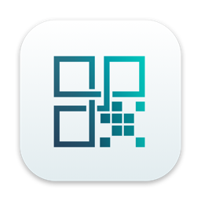

<h1 align="center">Tethera</h1>

  <b>A native VNC remote desktop for iPhone, iPad and Mac.</b> 
  Fast, light and private: control your Mac, Linux and Windows computers from anywhere in your home or office.

  <b>English</b> · <a href="README.it.md">Italiano</a>

  
  
  

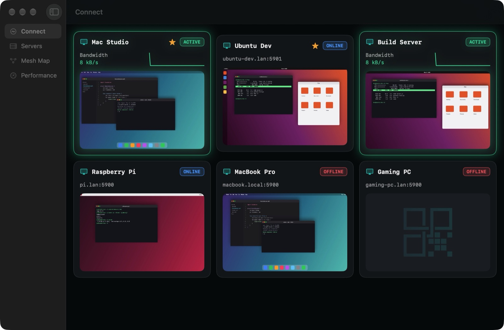

  <a href="video/tethera-mac-en.mp4">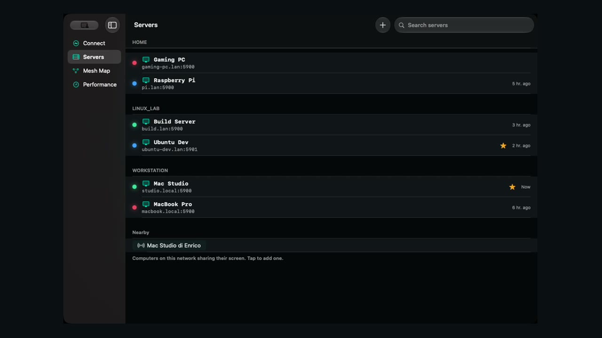</a> 
  ▶︎ <a href="video/tethera-mac-en.mp4">Watch the video (40 s)</a>

## Contents

- [Features](#features)
- [System requirements](#system-requirements)
- [Download](#download)
- [User guide](#user-guide)
  - [1. Prepare the computer to control](#1-prepare-the-computer-to-control)
  - [2. Add a server](#2-add-a-server)
  - [3. Connect](#3-connect)
  - [4. Touch gestures: a mouse under your finger](#4-touch-gestures-a-mouse-under-your-finger)
  - [5. Keyboard and Macro Bar](#5-keyboard-and-macro-bar)
  - [6. Copy and paste](#6-copy-and-paste)
  - [7. Zoom, orientation and the session bar](#7-zoom-orientation-and-the-session-bar)
  - [8. Profiles and resolution](#8-profiles-and-resolution)
  - [9. Encrypted connections: SSH tunnel](#9-encrypted-connections-ssh-tunnel)
  - [10. Sync between iPhone, iPad and Mac](#10-sync-between-iphone-ipad-and-mac)
  - [11. Wake-on-LAN and nearby computers](#11-wake-on-lan-and-nearby-computers)
  - [12. Home, Mesh Map and Performance](#12-home-mesh-map-and-performance)
  - [13. Siri, Shortcuts, widgets and Handoff](#13-siri-shortcuts-widgets-and-handoff)
  - [14. Settings](#14-settings)
  - [15. On the Mac](#15-on-the-mac)
  - [Keyboard shortcuts](#keyboard-shortcuts)
- [Security and privacy](#security-and-privacy)
- [Troubleshooting](#troubleshooting)
- [Support](#support)

## Features

- **Works with every VNC server**: macOS Screen Sharing (with your Mac account), TigerVNC, x11vnc, wayvnc on Linux,
  TightVNC, UltraVNC and RealVNC on Windows, Raspberry Pi.
- **Smooth and sharp**: GPU (Metal) rendering, modern compressed encodings, hardware H.264 video with wayvnc.
- **Your finger is a mouse**: tap, double tap, tap and drag to select, two fingers for right click and scrolling,
  three fingers for middle click; or a laptop-style trackpad mode. Apple Pencil, mouse and trackpad too.
- **Copy and paste that just works**: ⌘C and ⌘V copy and paste on the remote computer, and text travels between it
  and your iPhone, iPad or Mac in both directions.
- **Macro Bar**: Esc, Tab, Ctrl, Alt, ⌘, arrows, F-keys and Ctrl+Alt+Del, always at hand above the keyboard.
- **Zoom and landscape**: pinch to zoom up to 8×, iPhone in portrait or landscape, a session bar you can fold away.
- **Encrypted when you need it**: built-in SSH tunnel; a lock shows at a glance whether the session is encrypted.
- **Live previews**: the home shows each computer's screen, online status and bandwidth.
- **iCloud sync**: your servers and their passwords on all your iPhone, iPad and Mac, with no account to create.
- **Wake-on-LAN**, nearby computers found automatically, `vnc://` links.
- **Siri, Shortcuts, Spotlight, widgets, Control Center, Live Activity, Handoff and Focus filters.**
- **Light**: about 100 MB of memory and no CPU while the remote screen is still.
- **5 languages**: English, Italiano, Français, Deutsch, Español, with a built-in guide.

| | |
|---|---|
| 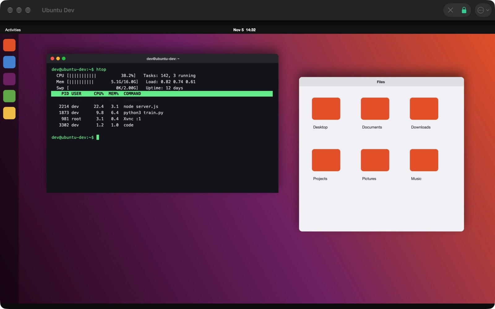 | 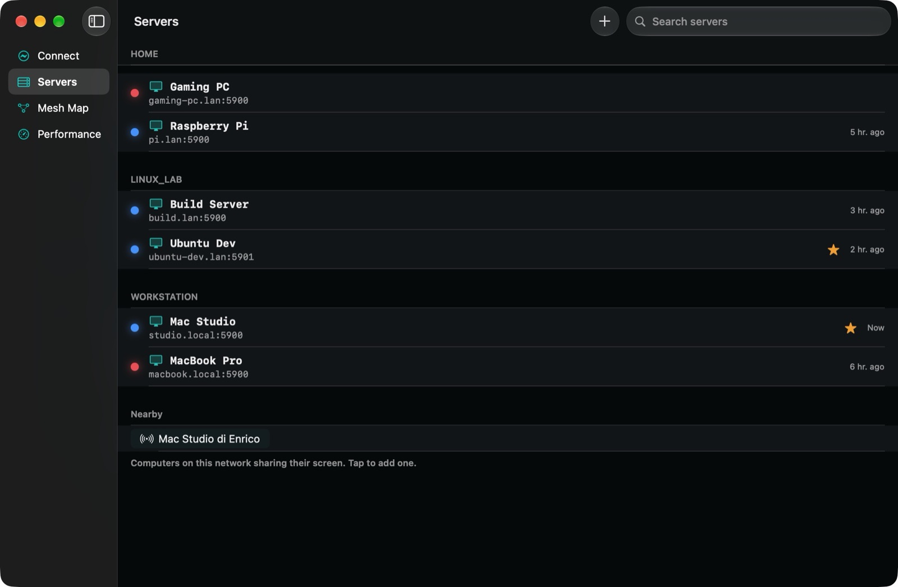 |
| A session in its own window | Servers by group, favourites and nearby computers |
| 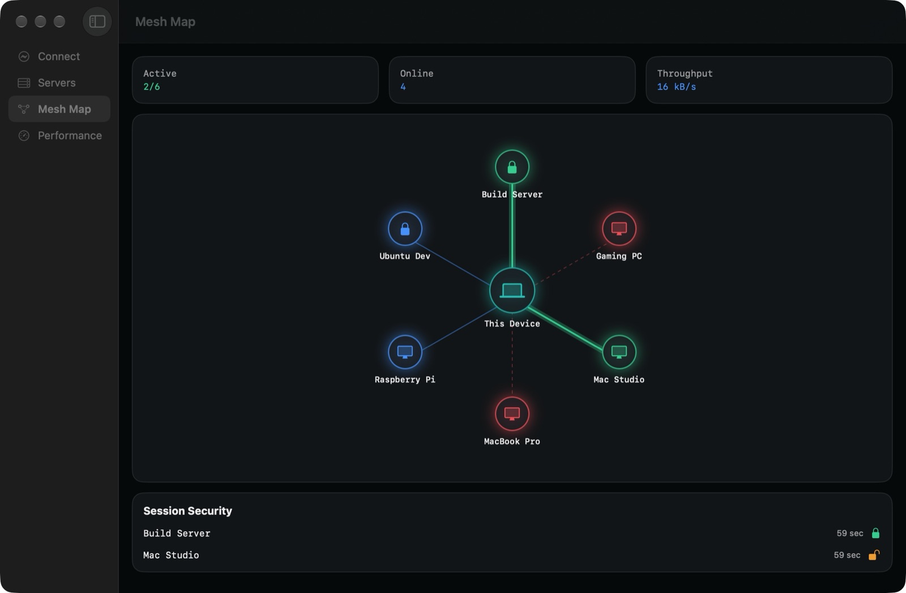 | 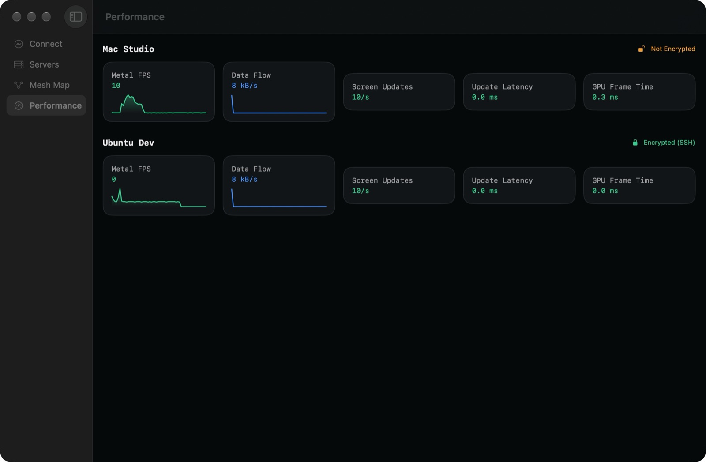 |
| Mesh Map: which computers are online, active and encrypted | Performance: frame rate, data flow, latency |
| 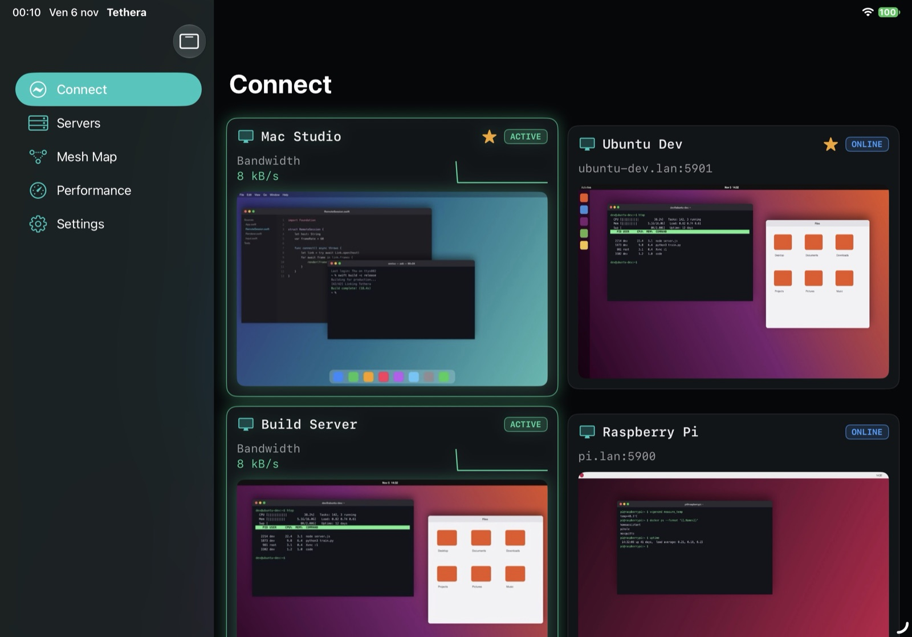 | 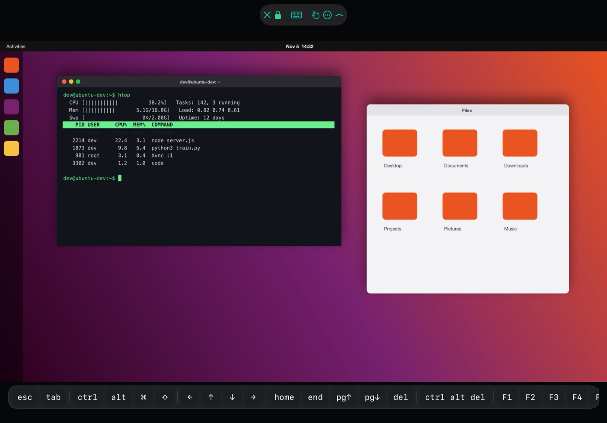 |
| iPad: home with live previews | iPad: session with the Macro Bar |
| 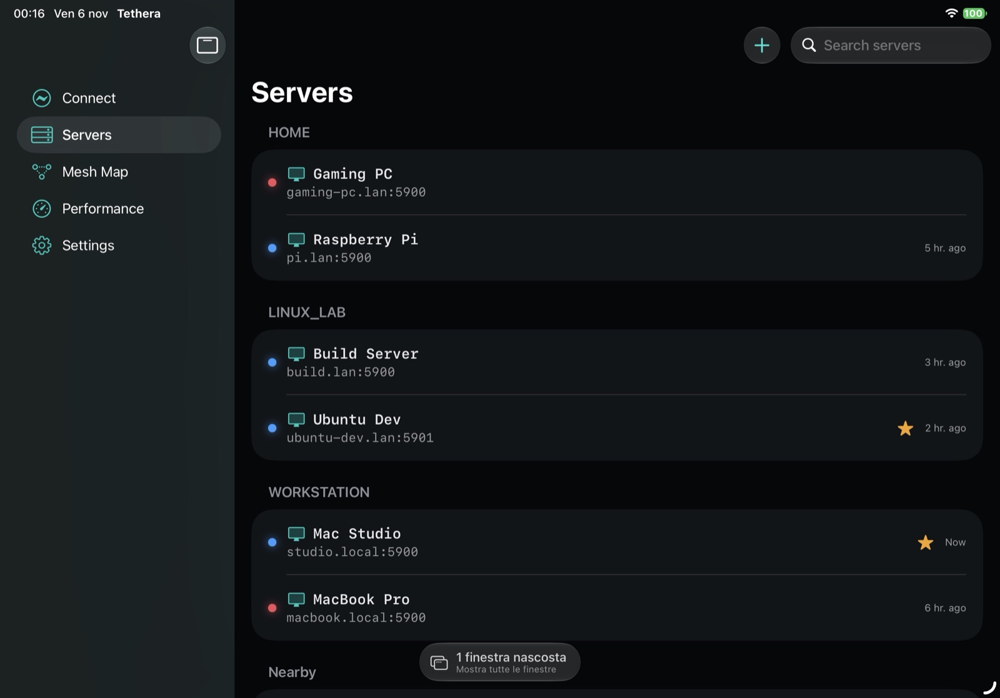 | 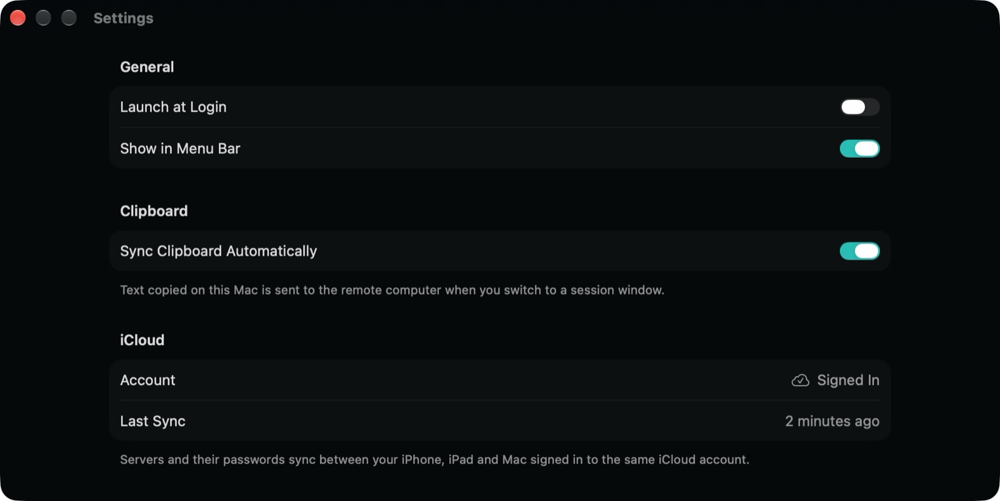 |
| iPad: servers | Settings |

  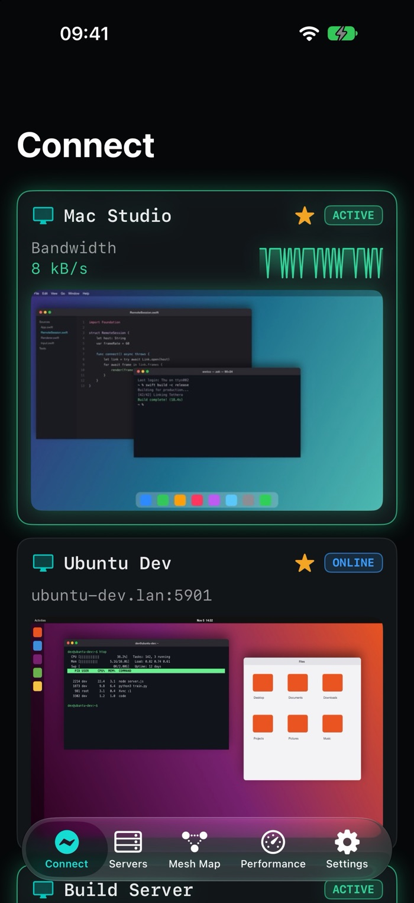
  &nbsp;
  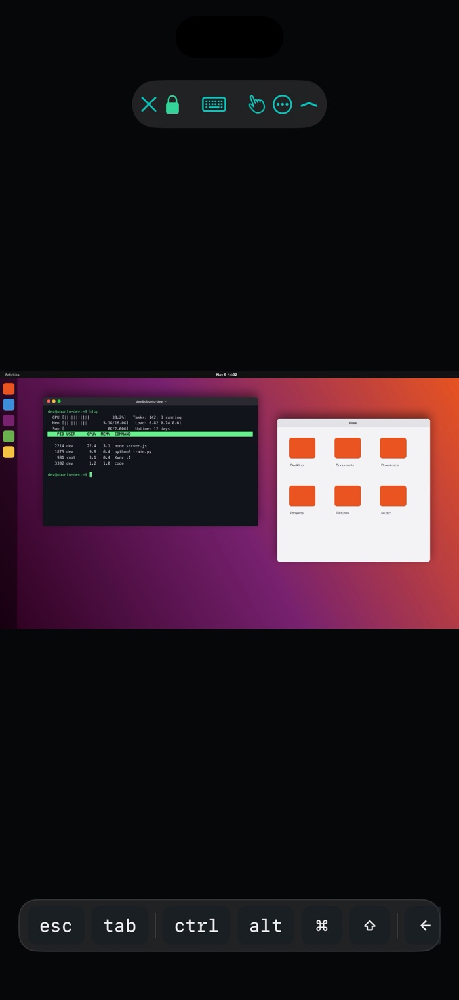
  &nbsp;
  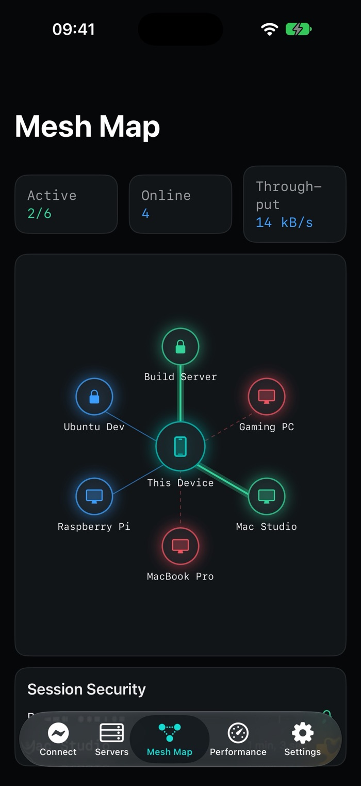

  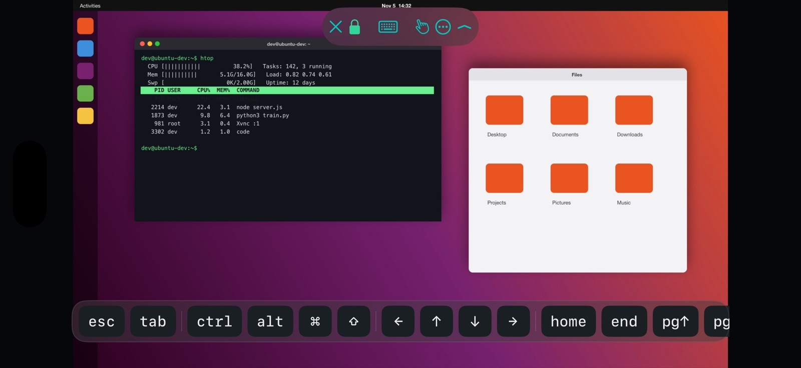

## System requirements

| | iPhone | iPad | Mac |
|---|---|---|---|
| **Operating system** | iOS 18 or later | iPadOS 18 or later | macOS 15 Sequoia or later |
| **Devices** | iPhone XS, XR or later | iPad (7th gen.), iPad mini (5th gen.), iPad Air (3rd gen.), iPad Pro 11" (1st gen.) / 12.9" (3rd gen.) or later | Apple silicon (M1 or later) or Intel Macs that run macOS 15 |
| **Liquid Glass look** | iOS 26 | iPadOS 26 | macOS 26 Tahoe |
| **App lock (optional)** | Face ID, Touch ID or passcode | Face ID, Touch ID or passcode | Touch ID or Mac password |
| **Keyboard and pointer** | Optional | Optional (Magic Keyboard, trackpad, mouse, Apple Pencil) | Built in |

You also need a computer with a **VNC server** turned on, reachable from your device: on your network, or from
outside through a VPN (for example Tailscale) or an SSH tunnel.

## Download

Tethera is coming to the App Store for iPhone, iPad and Mac. The **Mac version** can be downloaded from the
[Releases](https://github.com/kikoz85/Tethera/releases) page of this repository, where every new version is
published with its release notes. The Mac app updates itself when a new version comes out.

## User guide

### 1. Prepare the computer to control

- **Mac**: System Settings → General → Sharing → **Screen Sharing** on. In Tethera you sign in with the name and
  password of a Mac account allowed to use Screen Sharing.
- **Linux**: install a VNC server such as **TigerVNC** (`vncserver`), **x11vnc** or, on Wayland, **wayvnc**, and set
  a VNC password.
- **Windows**: install **TightVNC**, **UltraVNC** or **RealVNC Server** and set a VNC password.
- **Raspberry Pi**: Raspberry Pi Configuration → Interfaces → **VNC** on.

Write down the computer's address (for example `192.168.1.50`) and the port (usually `5900`; TigerVNC uses
`5901` for display `:1`).

### 2. Add a server

1. Open **Servers** and press **+** (or ⇧⌘N on Mac).
2. Fill in **Name** (what you will see in the list), **Host** (IP address or name) and **Port**.
3. Optional: a **Group** (Workstation, Linux lab…), **Favorite**, the **User Name** for a Mac, and a **Password**.
   Passwords go to the Keychain.
4. Press **Save**.

Faster ways: computers sharing their screen on your network appear under **Nearby**, tap one to add it; a
`vnc://192.168.1.50:5901` link opened from Safari, Notes or Messages opens the editor already filled in.

### 3. Connect

Tap a server in **Connect** or **Servers**. On iPhone the session fills the screen; on iPad and Mac each session
has its **own window**, so you can keep several computers side by side.

If the server asks for a password you didn't save, Tethera asks for it right there and saves it in the Keychain
for the next time (for a Mac, also the account name). A badge on each server shows whether it is **Online**,
**Offline** or **Active** (connected).

### 4. Touch gestures: a mouse under your finger

In **Direct Touch** mode the pointer goes where you touch:

| Gesture | Mouse equivalent |
|---|---|
| Slide one finger | Move the pointer |
| Tap | Left click |
| Double tap | Double click |
| **Tap, then touch again and drag** | Hold the left button: select text, move windows and icons |
| Two-finger tap | Right click |
| Two-finger slide | Scroll wheel (or move around when zoomed in) |
| Three-finger tap | Middle click |
| Long press | Right click; move after the long press to drag |
| Pinch | Zoom |

**Trackpad** mode (the hand button in the session bar, or Settings → Touch Input) works like a laptop trackpad:
your finger moves the pointer from where it is, tap clicks there. A hardware mouse or trackpad on iPad always points
directly, with hover, right click and scrolling.

### 5. Keyboard and Macro Bar

Tap the **keyboard** button in the session bar to show the on-screen keyboard. The **Macro Bar** above it has the
keys a touch keyboard lacks: **esc**, **tab**, **ctrl**, **alt**, **⌘**, **⇧**, arrows, **home**, **end**, page up and
down, **del**, **ctrl alt del** and **F1–F12**.

**ctrl**, **alt**, **⌘** and **⇧** stay pressed for the next key: tap **ctrl**, then **a**, to send Ctrl+A. A hardware
keyboard works as on a computer; the Macro Bar can be turned off in Settings.

### 6. Copy and paste

- **⌘C / ⌘X** in the session copy or cut on the remote computer (Tethera sends Ctrl+C on Windows and Linux, ⌘C on
  a Mac) and the text arrives in your clipboard, ready to paste in any app.
- **⌘V** pastes on the remote computer what you copied on your iPhone, iPad or Mac.
- **⌘A** and **⌘Z** select all and undo, also with a hardware keyboard on iPad.
- Text copied on the remote computer (with its own menus or shortcuts) always arrives in your clipboard.
- On iPhone and iPad without a keyboard: **More (⋯) → Send Clipboard**, then paste on the remote computer, or
  **Type Clipboard** to type it key by key (useful in login windows that don't accept paste).

### 7. Zoom, orientation and the session bar

- **Pinch** to zoom up to 8×, then drag with **two fingers** to move around. **More (⋯) → Actual Size** goes back.
- Turn the **iPhone sideways** to see a wide screen bigger.
- The **⌃** button at the end of the session bar folds it into a small handle at the top, so it doesn't cover the
  remote screen; tap the handle to bring it back.
- The **lock** shows whether the session is encrypted: green with an SSH tunnel, orange without. Tap it for details.
- **✕** closes the session.

### 8. Profiles and resolution

In the server editor, under **Display**:

- **Optimized** (default): compressed encodings and a local cursor, the best for most servers.
- **Video (H.264)**: hardware video decoding for smooth motion, with servers that support it such as **wayvnc**.
- **Compatibility**: simple encodings for old servers that show garbled images.
- **Match Resolution to Window**: the remote desktop takes the size of your window or screen (TigerVNC, wayvnc).

### 9. Encrypted connections: SSH tunnel

Plain VNC only protects the password, not the screen and keys. On networks you don't trust, use the **SSH tunnel**:

1. In the server editor turn on **Use SSH Tunnel** and fill in **SSH Host** (if different), **SSH Port** and
   **SSH User Name**, plus the **SSH Password** if you don't use a key.
2. Better, use a key: Settings → **SSH Key** → **Generate Key**, then **Copy Public Key** and add it to
   `~/.ssh/authorized_keys` on the server. The private key never leaves the Keychain.
3. The first time, Tethera shows the server's **fingerprint**: compare it and trust it. If it ever changes, Tethera
   warns you before connecting.

VNC then connects to the port you set **on the SSH server itself** (localhost), so the VNC server can stay
closed to the network.

### 10. Sync between iPhone, iPad and Mac

Tethera uses **your own iCloud**: there is no account to create. Sign in with the same Apple Account on every
device and the servers you add appear everywhere within seconds, with their passwords (through the iCloud
Keychain). **Settings → iCloud** shows whether you are signed in and when the last sync happened.

### 11. Wake-on-LAN and nearby computers

Add the computer's **MAC Address** in the server editor: when it is asleep, **Wake** (touch and hold the server, or
ask Siri "Wake Studio with Tethera") sends the magic packet. It works on the local network.

**Nearby** in Servers lists the computers on your network that announce Screen Sharing or VNC (Bonjour).

### 12. Home, Mesh Map and Performance

- **Connect** (home): a card for each server with a preview of its screen, its status and, while connected, the
  bandwidth.
- **Mesh Map**: your device in the middle and your computers around it, coloured by status, with a lock on the
  encrypted sessions.
- **Performance**: for each open session, frame rate, data flow, screen updates, latency and GPU time.

### 13. Siri, Shortcuts, widgets and Handoff

- **Siri**: "Connect to Studio with Tethera", "Open Studio in Tethera", "Wake Studio with Tethera".
- **Shortcuts and Spotlight**: a Connect and a Wake action for each server; type a server's name in Spotlight.
- **Widgets**: your favourite servers on the Home Screen, the Lock Screen and the Mac desktop; a button in
  **Control Center**.
- **Live Activity**: on iPhone the open session stays visible on the Lock Screen and in the Dynamic Island.
- **Handoff**: the session open on one device is offered on the others (Dock on Mac and iPad, app switcher on iPhone).
- **Focus**: a Focus filter shows only one group of servers, for example Work.

### 14. Settings

- **Input**: Direct Touch or Trackpad, Macro Bar on or off.
- **iCloud**: account status and last sync.
- **Security**: **Require Face ID** (or Touch ID) locks Tethera when it goes to the background.
- **SSH Key**: generate, import, share or remove the key used by SSH tunnels.
- **Appearance**: Dark Cyan or Amaranth theme, also in the widgets.
- **Language**: *Automatic* follows your system language (English if yours isn't available), or choose English,
  Italiano, Français, Deutsch or Español. It applies the next time Tethera opens; on Mac you can restart it right away.
- **Guide**: every feature explained step by step, also from the Help menu on Mac (⌘?).

### 15. On the Mac

- Each session opens in its **own window**: put computers on different displays or Spaces.
- The **menu bar** icon lists your active sessions and servers; Tethera can **launch at login** (Settings → General).
- **Sync Clipboard Automatically**: text copied on the Mac is sent to the remote computer when you switch to its window.
- The **Session** menu has Ctrl+Alt+Del, Send/Type Clipboard and zoom.

### Keyboard shortcuts

| Keys | Action |
|---|---|
| ⌘C ⌘X ⌘V | Copy, cut, paste on the remote computer (clipboard synced) |
| ⌘A ⌘Z | Select all, undo on the remote computer |
| ⇧⌘V | Send the clipboard to the remote computer |
| ⌥⌘V | Type the clipboard key by key |
| ⌃⌥⌫ | Send Ctrl+Alt+Del |
| ⌘+ ⌘- ⌘0 | Zoom in, zoom out, actual size |
| ⇧⌘N | New server |
| ⌘, | Settings (Mac) |
| ⌘? | Tethera Guide (Mac) |

## Security and privacy

- Passwords and the SSH key are stored only in the **Keychain** of your devices; with iCloud they travel through
  your own iCloud Keychain, end-to-end encrypted.
- With the **SSH tunnel** screen and keyboard are encrypted; the server's identity is checked with its fingerprint.
- Optional **Face ID / Touch ID** lock when the app goes to the background.
- No accounts, no analytics, no tracking: Tethera connects only to the computers you add (and, for sync, to your
  own iCloud).

## Troubleshooting

| Problem | What to do |
|---|---|
| "This server requires a password" | Type the VNC password (for a Mac, account name and password) and press **Connect**: it is saved for next time. |
| "Too many security failures" (TigerVNC) | The server blocked your device after failed attempts. Wait, or restart the VNC server (`vncserver -kill :1`, then `vncserver :1`), then connect with the right password. |
| A Windows PC shows **Offline** but is on | Tethera checks with a ping: allow ICMP echo in Windows Firewall, or just connect anyway. |
| Garbled or wrong colours | Edit the server and choose the **Compatibility** profile. |
| ⌘V pastes the wrong text | Copy the text again on your device; on iPhone and iPad allow Tethera to paste when asked. |
| The remote screen is too small on iPhone | Pinch to zoom, turn the iPhone sideways, or turn on **Match Resolution to Window**. |
| A server doesn't appear on another device | Check Settings → **iCloud**: you must be signed in with the same Apple Account. |
| Can't reach the computer from outside home | Use a VPN such as Tailscale, or the SSH tunnel: never expose VNC to the Internet. |

## Support

- Bugs and suggestions: open an [issue](https://github.com/kikoz85/Tethera/issues) or write to enricofanucchi@gmail.com
- Support development: [GitHub Sponsors](https://github.com/sponsors/kikoz85)
- Developer: Enrico Fanucchi · [www.enricofanucchi.com](https://www.enricofanucchi.com)

© 2026 Enrico Fanucchi
